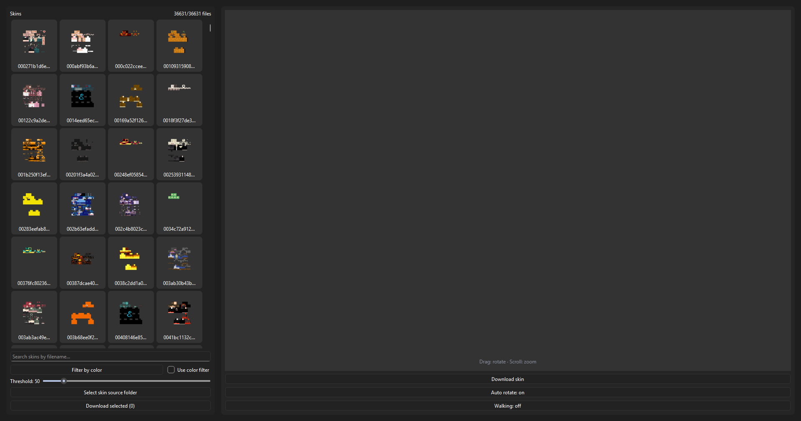

# Minecraft Skin Extractor

View and extract Minecraft skins cached from the servers you play on.

## Screenshots 



## Getting Started
### Requirements
- Python 3.10+ (tested on 3.10)

> **Note:** If you're not using Windows, you'll need to install the dependencies manually and run the application using Python.

### Installation
**Option 1: Download ZIP**

1. [Download and extract the ZIP file](https://github.com/Kuppiarda/minecraft-skin-extractor/archive/refs/heads/main.zip).
2. Run `setup.bat` or manually install the dependencies using `pip install -r requirements.txt`.

**Option 2: Clone with Git**
```
git clone https://github.com/Kuppiarda/minecraft-skin-extractor.git
cd minecraft-skin-extractor
setup.bat
```

### Running
Run `run_ui.bat` or activate the virtual environment (`.venv\Scripts\activate`) and then execute `python main.py`.

## Third-Party Libraries

- [skinview3d](https://github.com/bs-community/skinview3d) - MIT License
- [PySide6](https://doc.qt.io/qtforpython-6/) - LGPLv3 License
- [Pillow](https://python-pillow.org/) - MIT-CMU License

## License

This project is licensed under the GNU General Public License v3.0. See the [LICENSE](LICENSE) file for details.

Third-party libraries are distributed under their respective licenses. See the [THIRD-PARTY-LICENSES](THIRD-PARTY-LICENSES) directory for additional license information.
